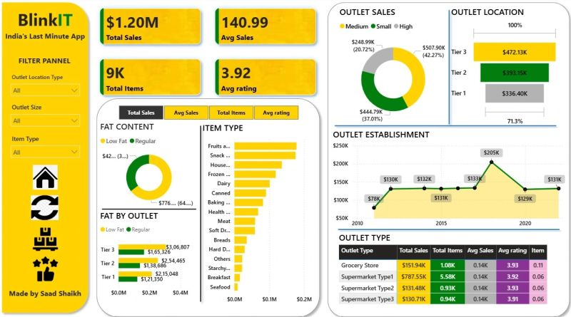
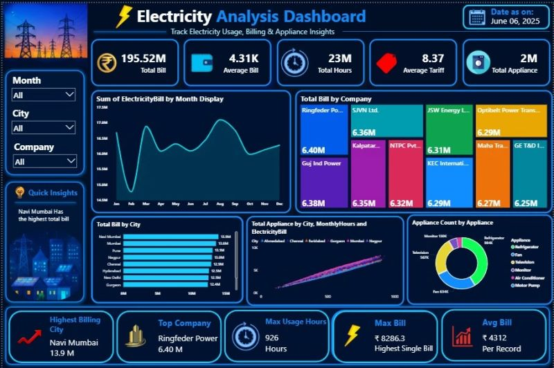
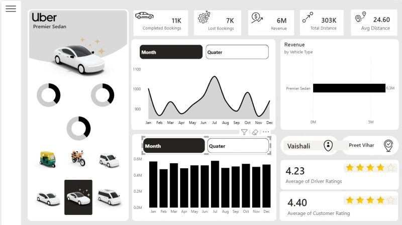
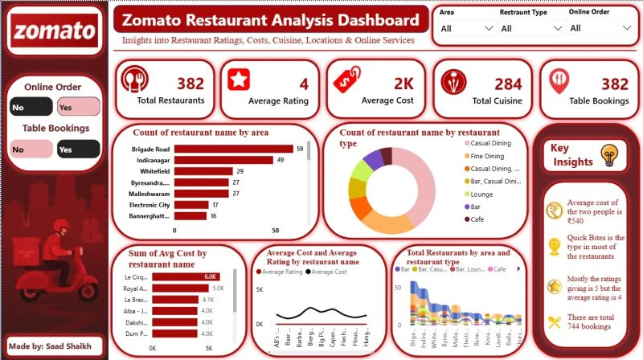

# Power BI Projects

A collection of interactive dashboards built with Microsoft Power BI. Open a project file in Power BI Desktop to explore its report.

## Projects

| Project | Power BI file |
|---|---|
| Blinkit | [BlinkIT.pbix](./Blinkit/BlinkIT.pbix) |
| Electricity Analysis | [Electricity Analysis Dashboard.pbix](./Electricity/Electricity%20Analysis%20Dashboard.pbix) |
| Uber | [Uber.pbix](./Uber/Uber.pbix) |
| Zomato | [Zomato Project.pbix](./Zomato/Zomato%20Project.pbix) |

## Dashboard Previews

### Blinkit

The dashboard highlights sales performance, average sales and ratings, product mix, outlet locations, and outlet types.

### Electricity Analysis

The dashboard brings together electricity billing, usage, tariff, appliance, company, and city insights, with filters for month, city, and company.

### Uber

The dashboard summarizes bookings, revenue, distance, and ratings, with trends over time and revenue comparisons by vehicle type.

### Zomato

The dashboard explores restaurant ratings, costs, cuisines, bookings, and locations, with filters for area, restaurant type, and online orders.

